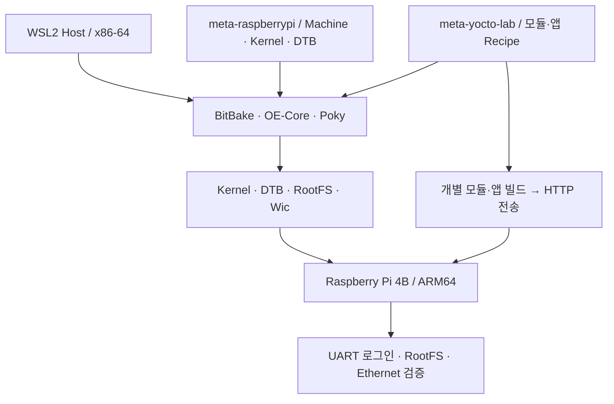

# Yocto Raspberry Pi 4 Lab

**Yocto Project로 Raspberry Pi 4B용 최소 ARM64 Linux 이미지를 구성·빌드·배포하고, UART·RootFS·Ethernet·외부 커널 모듈을 실장비에서 검증한 프로젝트입니다.**

**핵심 기술:** Yocto Project 6.0.4 (`wrynose`) · BitBake 2.18.0 · `meta-raspberrypi` BSP · Custom Layer / Recipe · Linux `6.18.33-v8` · ARM64

BSP의 Machine·Kernel Provider와 패키지 의존성을 분석하고, `core-image-minimal`을 빌드해 보드에서 동작을 확인했습니다. 또한 직접 작성한 커널 모듈과 C 테스트 애플리케이션을 사용자 Layer의 Recipe로 ARM64 타깃에 맞게 크로스 빌드하고 배포했습니다.

## 검증 결과 한눈에 보기

| 영역 | 구현·검증 결과 | 기술적 근거 |
|---|---|---|
| BitBake / BSP 분석 | **992 Recipe Parse, 0 errors**; Machine·Provider·Task 의존성 확인 | [Chapter 2](docs/02-bitbake-layer-recipe.md) |
| ARM64 이미지 빌드 | `core-image-minimal` 최초 빌드 **4,025 Tasks 성공** | [Chapter 3](docs/03-arm64-image-build.md) |
| RootFS / Wic | ARM64 Kernel·DTB·RootFS 식별, 압축 검사 통과; **172.4 MiB Wic의 2개 파티션** 확인 | [Chapter 4](docs/04-rootfs-analysis.md) |
| 실장비 부팅·통신 | **UART root 로그인**, ext4 RootFS, Ethernet DHCP, 외부 IP ping **4/4** | [Chapter 5](docs/05-raspberrypi-boot.md) |
| Custom Layer / Recipe | `hello_drv.ko` 빌드·적재·제거; 후속 모듈·C 앱 ARM64 빌드, `chain_lab.ko` 전송 SHA-256 일치 | [Chapter 6](docs/06-custom-layer.md) · [검증 로그](docs/logs/06-module-packaging.md) |
| 8채널 GPIO 제어 | 직접 구현한 Platform Driver·C 애플리케이션으로 **버튼 8개·LED 8개 독립 토글 동작 확인** | [Chapter 7 — GPIO 시스템 통합 설계](docs/07-gpio-toggle-image.md) |

**주요 문제 해결:** root 로그인 실패는 개발용 Configuration Fragment 적용·증분 빌드·재기록으로 해결했습니다. 외부 모듈의 `do_configure` 오류는 Makefile의 `clean` 규칙을 보완해 해결했고, 배포 파일은 Host·공유 폴더·Target의 해시를 대조했습니다.

## 시스템 구성과 작업 흐름



이미지 빌드·실장비 검증은 **주 빌드 환경(센터)**, Recipe Parse·메타데이터 분석은 **보조 개발 환경(집)**에서 수행했습니다. 직접 작성한 외부 모듈·앱은 개별 파일 전송과 타깃 실행으로 검증했습니다.

직접 개발한 GPIO 제어 기능의 **Yocto 이미지 통합 설계**는 [Chapter 7](docs/07-gpio-toggle-image.md)에 정리했습니다.

## 개발 환경

| 항목 | 센터 | 집 |
|---|---|---|
| Host OS | WSL2 Ubuntu 22.04 | WSL2 Ubuntu 26.04.1 LTS |
| CPU / RAM | 24 논리 CPU / 15GiB | 8 논리 CPU / 7.6GiB |
| `BB_NUMBER_THREADS` | `4` | `2` |
| `PARALLEL_MAKE` | `-j 4` | `-j 2` |
| 수행 범위 | 이미지 빌드·실장비 검증 | 환경 구성·Recipe Parse·메타데이터 분석 |

공통 구성: **Raspberry Pi 4 Model B**, ARM64/AArch64, Yocto Project **6.0.4 (`wrynose`)**, `DISTRO=poky`, `MACHINE=raspberrypi4-64`, BSP Layer **`meta-raspberrypi`**.

Host별 경로·설정은 [Chapter 1](docs/01-environment.md)과 [빌드 설정](configs/build-config.md), 소스 기준은 [리비전 기록](configs/source-revisions.md)에서 확인할 수 있습니다.

## 문서 바로가기

| 문서 | 확인할 기술 내용 |
|---|---|
| [Chapter 1 — 환경 구성](docs/01-environment.md) | Setup, Locale 해결, BSP Layer·Machine 설정 |
| [Chapter 2 — BitBake·Layer·Recipe](docs/02-bitbake-layer-recipe.md) | Provider, Task 그래프, 패키지 의존성, Configuration Fragment |
| [Chapter 3 — ARM64 Image Build](docs/03-arm64-image-build.md) | 4,025 Tasks 빌드, Fetch 경고 추적, 배포 산출물 검사 |
| [Chapter 4 — RootFS·Wic 분석](docs/04-rootfs-analysis.md) | 산출물 역할, 부팅 파티션·RootFS, 빌드 설정과 실행 결과 연결 |
| [Chapter 5 — 실장비 부팅·검증](docs/05-raspberrypi-boot.md) | UART, 로그인 정책·증분 빌드, Ethernet, hello-drv 실장비 로그 |
| [Chapter 6 — Custom Layer·모듈·앱 Recipe](docs/06-custom-layer.md) | 소스 스테이징, Kbuild·sysroot, 빌드 오류 해결, 파일 무결성 |
| [Chapter 7 — GPIO Device Driver 및 Yocto 시스템 통합 설계](docs/07-gpio-toggle-image.md) | 직접 개발한 8채널 GPIO 제어, Device Tree·RootFS·부팅 서비스 구성 |
| [실행 근거](docs/logs/06-module-packaging.md) | [센터 환경](docs/logs/01-center-setup.md) · [집 환경](docs/logs/01-home-setup.md) · 모듈 빌드·전송 |
| [hello-drv 예제](examples/hello-drv/README.md) | 커널 모듈 C 소스, Makefile, Yocto Recipe |
| [빌드 설정](configs/build-config.md) · [소스 리비전](configs/source-revisions.md) | 환경별 적용값과 고정 revision |

## 저장소 구조

```text
yocto-rpi4-lab/
├── README.md
├── configs/
│   ├── build-config.md
│   └── source-revisions.md
├── examples/
│   └── hello-drv/
│       ├── README.md
│       ├── hello-drv_1.0.bb
│       └── files/
│           ├── hello_drv.c
│           └── Makefile
└── docs/
    ├── 01-environment.md
    ├── 02-bitbake-layer-recipe.md
    ├── 03-arm64-image-build.md
    ├── 04-rootfs-analysis.md
    ├── 05-raspberrypi-boot.md
    ├── 06-custom-layer.md
    ├── 07-gpio-toggle-image.md
    └── logs/
        ├── 01-center-setup.md
        ├── 01-home-setup.md
        └── 06-module-packaging.md
```

직접 개발한 Linux Device Driver와 GPIO 제어 애플리케이션의 소스는 [linux-system-programming](https://github.com/triton0305/linux-system-programming/blob/56a431d1e633d90f1bfe98a3a7bfaa026494862c/ch07-platform-gpio/userspace/lab_gpio_test.c)에서 관리합니다. 이 저장소에는 해당 소프트웨어를 대상으로 한 Yocto 빌드 구성, ARM64 배포·검증 및 시스템 통합 설계를 기록합니다.
