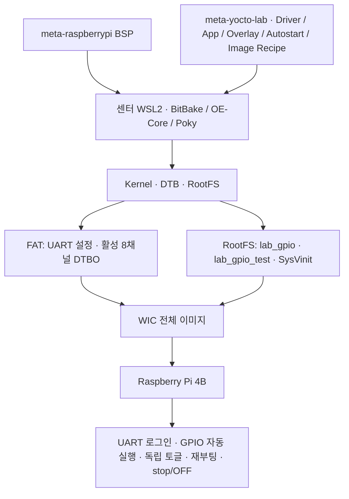

# Yocto Raspberry Pi 4B — UART·GPIO 8채널 통합 이미지

**직접 개발한 GPIO Platform Driver와 C 애플리케이션을 Yocto ARM64 WIC 이미지에 통합했습니다.**

**2026-10-30 Raspberry Pi 4B 실장비 검증 완료:** UART 암호 로그인, 부팅 시 GPIO 8채널 자동 실행, 버튼별 독립 LED 토글, 재부팅 후 자동 실행, 정상 stop 및 LED OFF를 확인했습니다. **HW VERIFIED의 근거는 사용자 제공 UART 결과 요약과 육안 관찰**이며, [항목별 증거와 확인 범위](docs/logs/07-gpio-image-hardware-20261030.md)를 구분해 기록했습니다.

**핵심 기술:** Yocto Project 6.0.4 (`wrynose`) · BitBake 2.18.0 · `meta-raspberrypi` · Custom Layer / Recipe · Linux `6.18.33-v8` · ARM64 · Device Tree Overlay · SysVinit · C

최종 `yocto-gpio-toggle-image`는 **4,128 Tasks 모두 성공**했고, WIC 내부 FAT/RootFS·AArch64 ELF·모듈 ABI·UART/getty·인증 구성을 Host에서 검사했습니다. 2026-10-30에는 보존된 빌드 로그를 대조하고 이미지 해시·압축 무결성을 다시 확인했습니다. 새 BitBake 빌드를 실행한 것은 아닙니다.

- 압축 이미지: `yocto-gpio-toggle-image-raspberrypi4-64.rootfs-20261029073227.wic.bz2` — **40,615,730 bytes**
- SHA-256: `be2a97c59ba7f2c2595130f14de9e09dfcf70ffda0cf3baa9a3d9001e48233eb`
- [통합 구현과 소스](docs/07-gpio-toggle-image.md) · [최종 산출물·검증 보고서](docs/final-uart-gpio8-image.md) · [Host 증거 발췌](docs/logs/07-gpio-image-host.md)

## 최종 시스템



Driver·C 앱은 직접 개발했으며, OE-Core·Poky·`meta-raspberrypi`의 빌드·보드 지원 기능을 기반으로 통합했습니다. GPIO 앱의 **20ms polling / 3연속 샘플 debounce**는 코드의 동작 설정이며 IRQ나 하드 실시간 지연 보장이 아닙니다.

## 통합 과정의 핵심 문제 해결

| 문제 | 구현과 확인 근거 |
|---|---|
| 빌드된 모듈이 이미지에 포함되도록 연결 | `lab-gpio` 메타패키지가 실제 `kernel-module-lab-gpio-6.18.33-v8`을 의존. DNF 별칭 실패를 해결하고 manifest 확인 — [Image Recipe](layers/meta-yocto-lab/recipes-core/images/yocto-gpio-toggle-image.bb) |
| DTBO 컴파일과 실제 FAT 배포 연결 | `devicetree` deploy 의존성, `IMAGE_BOOT_FILES`, 이미지 전용 config의 `[all]` 활성화 — [Overlay Recipe](layers/meta-yocto-lab/recipes-bsp/lab-gpio-overlay/lab-gpio-overlay_1.0.bb) |
| 장치 준비 지연·중복 시작·잘못된 status 판정 | 100ms × 최대 50회 대기, 원본 앱 한 번 호출, 각 장치의 정확한 running 상태 검사 — [init 스크립트](layers/meta-yocto-lab/recipes-core/lab-gpio-autostart/files/lab-gpio-init) |
| 개발용 빈 암호 정책과 최종 인증 분리 | 최종 이미지만 빈 암호 기능 제거, `shadow` 로그인과 비공개 개별 hash 적용. 실장비에서 암호 변경·재부팅 후 로그인 유지 — [구성 및 근거](docs/07-gpio-toggle-image.md#6-uart와-인증-구성) |

## 이전 단계의 검증 성과

아래는 최종 GPIO 이미지와 구분되는 **기본 이미지 및 개별 모듈 배포** 기록입니다. 과거 명령·오류·출력은 각 Chapter에 보존했습니다.

| 영역 | 구현·검증 결과 | 기술적 근거 |
|---|---|---|
| BitBake / BSP 분석 | 992 Recipe Parse, 0 errors; Machine·Provider·Task 분석 | [Chapter 2](docs/02-bitbake-layer-recipe.md) |
| 기본 ARM64 이미지 | `core-image-minimal` 최초 4,025 Tasks 성공 | [Chapter 3](docs/03-arm64-image-build.md) |
| 기본 RootFS / WIC | 172.4 MiB WIC, MBR 2개 파티션 | [Chapter 4](docs/04-rootfs-analysis.md) |
| 부팅·통신 | UART root 로그인, ext4, Ethernet DHCP, 외부 IP ping 4/4 | [Chapter 5](docs/05-raspberrypi-boot.md) |
| Custom Layer / Recipe | hello_drv 적재·제거; 후속 모듈·앱 ARM64 빌드와 chain_lab 전송 SHA-256 대조 | [Chapter 6](docs/06-custom-layer.md) · [기존 로그](docs/logs/06-module-packaging.md) |

기본 이미지의 root 로그인 실패는 개발용 Configuration Fragment 적용·증분 빌드·재기록으로 해결했습니다. 개별 모듈의 `do_configure` 오류는 Makefile `clean` 규칙을 보완했고, Host·공유 폴더·Target의 해시를 비교했습니다. 이때의 HTTP 전송·수동 `insmod`는 최종 GPIO 이미지의 자동 설치·시작과 별개입니다.

## 개발 환경

| 항목 | 센터 | 집 |
|---|---|---|
| Host OS | WSL2 Ubuntu 22.04 | WSL2 Ubuntu 26.04.1 LTS |
| CPU / RAM | 24 논리 CPU / 15GiB | 8 논리 CPU / 7.6GiB |
| `BB_NUMBER_THREADS` | `4` | `2` |
| `PARALLEL_MAKE` | `-j 4` | `-j 2` |
| 수행 범위 | 이미지 빌드·실장비 검증 | 환경 구성·Recipe Parse·메타데이터 분석 |

공통 구성: **Raspberry Pi 4 Model B**, ARM64/AArch64, Yocto Project **6.0.4 (`wrynose`)**, `DISTRO=poky`, `MACHINE=raspberrypi4-64`, BSP Layer **`meta-raspberrypi`**.

Host별 경로·설정은 [Chapter 1](docs/01-environment.md)과 [빌드 설정](configs/build-config.md), 소스 기준은 [리비전 기록](configs/source-revisions.md)에서 확인할 수 있습니다.

## 문서 바로가기

| 문서 | 확인할 기술 내용 |
|---|---|
| [Chapter 1 — 환경 구성](docs/01-environment.md) | Setup, Locale 해결, BSP Layer·Machine 설정 |
| [Chapter 2 — BitBake·Layer·Recipe](docs/02-bitbake-layer-recipe.md) | Provider, Task 그래프, 패키지 의존성, Configuration Fragment |
| [Chapter 3 — ARM64 Image Build](docs/03-arm64-image-build.md) | 4,025 Tasks 빌드, Fetch 경고 추적, 배포 산출물 검사 |
| [Chapter 4 — RootFS·Wic 분석](docs/04-rootfs-analysis.md) | 산출물 역할, 부팅 파티션·RootFS, 빌드 설정과 실행 결과 연결 |
| [Chapter 5 — 실장비 부팅·검증](docs/05-raspberrypi-boot.md) | UART, 로그인 정책·증분 빌드, Ethernet, hello-drv 실장비 로그 |
| [Chapter 6 — Custom Layer·모듈·앱 Recipe](docs/06-custom-layer.md) | 소스 스테이징, Kbuild·sysroot, 빌드 오류 해결, 파일 무결성 |
| [Chapter 7 — GPIO 최종 이미지 구현·검증](docs/07-gpio-toggle-image.md) | 실제 Recipe·패키지, FAT Overlay, SysV 자동 실행과 검증 근거 |
| [실행 근거](docs/logs/06-module-packaging.md) | [센터 환경](docs/logs/01-center-setup.md) · [집 환경](docs/logs/01-home-setup.md) · 모듈 빌드·전송 |
| [hello-drv 예제](examples/hello-drv/README.md) | 커널 모듈 C 소스, Makefile, Yocto Recipe |
| [빌드 설정](configs/build-config.md) · [소스 리비전](configs/source-revisions.md) | 환경별 적용값과 고정 revision |
| [최종 이미지 증거 보고서](docs/final-uart-gpio8-image.md) | 이미지 식별·Host 검사·HW-01~08 및 근거의 한계 |
| [2026-10-30 HW 수락 기록](docs/logs/07-gpio-image-hardware-20261030.md) | 사용자 UART 결과 요약과 육안 관찰 구분 |
| [소스 구성·인증·재현 절차](docs/source-publication-review.md) | Layer 입력, 로컬 인증 생성, 빌드·검증 경로 |

## 저장소 구조

최종 GPIO 이미지의 Layer·Recipe·소스와 재현·검증 도구를 함께 관리합니다. 이미지 바이너리, 인증정보, 빌드 캐시와 로컬 검사 파일은 저장소에서 제외합니다.

```text
yocto-rpi4-lab/
├── README.md
├── .gitignore
├── configs/                    # build-config.md, source-revisions.md
├── examples/hello-drv/         # 기존 C·Makefile·Recipe·README
├── layers/meta-yocto-lab/
│   ├── conf/layer.conf
│   ├── recipes-kernel/lab-gpio/
│   ├── recipes-apps/lab-gpio-test/
│   ├── recipes-bsp/lab-gpio-overlay/
│   └── recipes-core/           # images, lab-gpio-autostart
├── scripts/
│   ├── prepare-gpio-credentials.py
│   ├── sync-gpio-layer.py
│   └── verify-gpio-wic.py
├── tests/test_gpio_init.py
└── docs/                       # Chapter 1~7, 최종 보고서, 소스·인증 안내, logs
```

[소스 구성과 빌드 준비](docs/source-publication-review.md)에서 전체 파일과 재현 조건을 확인할 수 있습니다. [인증 생성 도구](scripts/prepare-gpio-credentials.py)는 개발자별 초기 root 암호를 로컬에 생성하며 값을 출력하지 않습니다. 비어 있는 개인 빌드 경로를 확인하는 [인증 준비 절차](docs/source-publication-review.md#인증-생성-절차)를 따른 뒤 [최종 이미지 빌드·검사](docs/final-uart-gpio8-image.md#재현)를 진행합니다.

직접 개발한 GPIO 소스의 기준은 [linux-system-programming의 고정 SHA](https://github.com/triton0305/linux-system-programming/tree/56a431d1e633d90f1bfe98a3a7bfaa026494862c/ch07-platform-gpio)입니다. 이 저장소의 [통합 Layer](layers/meta-yocto-lab/conf/layer.conf)는 실제 빌드 입력과 동일한 사본이며, 활성 DTS는 원본 disabled 템플릿에서 8개 노드를 `okay`로 만든 별도 파일입니다.
